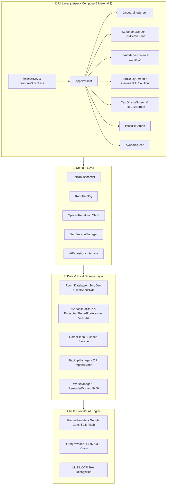

# 📚 Soru Defterim (Smart Exam Preparation & Question Archive)

<p align="center">
  
  
  
  
  
  
</p>

---

## 🎯 Proje Hakkında (About the Project)

**Soru Defterim**, YKS (TYT, AYT Sayısal, Eşit Ağırlık, Sözel, YDT), LGS ve KPSS sınavlarına hazırlanan öğrencilerin yapamadıkları ve hatalı çözdükleri soruları arşivleyip, **Yapay Zeka (AI)** ve **Aralıklı Tekrar (Spaced Repetition)** yöntemleriyle kalıcı öğrenmeye dönüştüren yeni nesil akıllı mobil sınav asistanıdır.

---

## 🏗️ Sistem Mimarisi (Architecture Overview)

Uygulama, **Clean Architecture**, **Single-Activity Architecture** ve **MVI / MVVM** desenlerini modern Android pratikleriyle uygular:



---

## ✨ Temel Özellikler (Key Features)

### 🚀 1. Onboarding & Zorunlu Alan Seçimi (P1-6)
- **4 Aşamalı Modern Tanıtım Carousel**: AI Soru Analizi, Spaced Repetition, Akıllı Kütüphane ve Şifreli Güvenlik özelliklerini interaktif kartlarla anlatır.
- **Zorunlu Alan (Track) Seçimi**: 
  1. Sayısal (YKS TYT + AYT)
  2. Eşit Ağırlık (YKS TYT + AYT)
  3. Sözel (YKS TYT + AYT)
  4. YDT (Yabancı Dil Testi)
  5. LGS (8. Sınıf Liselere Geçiş)
  6. KPSS (Genel Yetenek & Genel Kültür)
- Seçim yapılmadan ana ekrana geçilemez; seçim `AyarlarDataStore` içinde saklanır ve tüm müfredat ders listesi seçilen alana göre dinamik uyarlanır.

### ⏰ 2. Spaced Repetition & WorkManager Hatırlatıcı (P1-7)
- **SuperMemo-2 (SM-2)** tabanlı aralıklı tekrar algoritması (1, 3, 7, 14 ve 30 günlük aşamalar).
- **WorkManager PeriodicWorker (`ReminderWorker`)**:
  - Her gün saat **19:00**'da arka planda tetiklenir.
  - Vakti gelen soruları Room DAO üzerinden sorgular.
  - Varsa kullanıcıya bildirim gönderir: *"Tekrar Vakti! 📚 Bugün tekrar etmen gereken X soru var. Şimdi çözmeye başla!"*
  - Bildirime dokunulduğunda doğrudan test çözme ekranına yönlendirir.

### 📚 3. Kapsamlı Ders & Konu Kataloğu v1.2 (P1-10)
- `assets/konular.json` dosyası üzerinden tüm sınavlar için kapsamlı konu ağacı:
  - **TYT**: Türkçe, Matematik, Geometri, Fizik, Kimya, Biyoloji, Tarih, Coğrafya, Felsefe, Din Kültürü
  - **AYT**: Matematik, Geometri, Fizik, Kimya, Biyoloji, Türk Dili ve Edebiyatı, Tarih-1, Coğrafya-1, Tarih-2, Coğrafya-2, Felsefe Grubu (Mantık, Psikoloji, Sosyoloji), Din Kültürü, YDT İngilizce
  - **LGS**: Türkçe, Matematik, Fen Bilimleri, T.C. İnkılap Tarihi, Din Kültürü, İngilizce
  - **KPSS**: Genel Yetenek (Türkçe, Matematik), Genel Kültür (Tarih, Coğrafya, Vatandaşlık, Güncel Bilgiler)
- Konu kataloğu çevrimdışı, thread-safe önbellek ve *"Katalog hazırlanıyor..."* güvenli Fallback desteği sunar.

### 📱 4. Tablet & Responsive Tasarım (P1-11)
- `androidx.compose.material3.windowsizeclass` entegrasyonu:
  - **Kompakt Ekranlar (Telefon)**: Standart alt menü (`NavigationBar`).
  - **Orta ve Geniş Ekranlar (Tablet / Katlanabilir / Landscape)**: Yan menü (`NavigationRail`).
  - **Tablet Geniş Ekran Modu (List-Detail Pane)**: Kütüphane ekranında sol sütunda filtreli soru listesi, sağ sütunda seçilen sorunun tam detay ve AI çözüm önizleme kartı.

### 🤖 5. Yapay Zeka (AI) & LaTeX Matematiksel Formül Render (P0-3, P0-4)
- **Çoklu Sağlayıcı (Multi-Provider)**: Google Gemini (gemini-2.5-flash) ve Groq (LLaMA 3.2 11B Vision).
- **Canlı Model Listesi**: API anahtarı girildiğinde Google AI Studio ve Groq API'lerinden güncel modelleri dinamik olarak çeker.
- **LaTeX Math Render**: $...$ ve $$...$$ matematiksel ve fiziksel formüllerini WebView destekli KaTeX motoruyla kusursuz render eder.
- **Benzer Soru Üretimi**: Yapay zekaya hatalı sorulan sorunun benzerini (4 seçenekli ve çözümlü) ürettirir.

### 🔐 6. Donanım Destekli Şifreleme & Tam Yedekleme (P0-1, P0-2)
- **EncryptedSharedPreferences (AES-256 GCM)**: API anahtarları Android Keystore donanım anahtarlarıyla şifrelenir.
- **Şifreli ZIP Yedekleme**: Tüm Room veritabanı JSON manifesti ve soru görselleri tek bir `.sdefteri` / `.zip` dosyasında paketlenir.
- **Bulut / Drive Senkronizasyonu**: Android Sharesheet ile Google Drive, Telegram vb. bulut platformlarına tek tıkla aktarılabilir.

---

## 🛠️ Kurulum ve Çalıştırma (Setup & Run)

### Gereksinimler
- Android Studio Ladybug (2024.2.1+) veya üzeri
- JDK 17 (Eclipse Temurin / OpenJDK)
- Android SDK 35 (Android 15) & Min SDK 24 (Android 7.0)

### Projeyi Derleme
```bash
# Projeyi klonlayın
git clone https://github.com/haliskoc/soru-defterim.git
cd soru-defterim

# Birim testlerini çalıştırın
./gradlew testDebugUnitTest

# Debug APK derleyin
./gradlew assembleDebug

# Release APK ve App Bundle derleyin
./gradlew assembleRelease bundleRelease
```

---

## 🧪 Birim Testleri (Unit Tests)

Uygulama, Room Mapping, Spaced Repetition, Matematiksel LaTeX Parser ve Sınav Taksonomisi için kapsamlı test suite içerir:
```bash
./gradlew testDebugUnitTest --continue
```
- `DersTaksonomisiTest.kt`: TYT, AYT, YDT, LGS, KPSS ders haritalama testleri.
- `SpacedRepetitionTest.kt`: SM-2 aralıklı tekrar aşama ve gün hesaplama testleri.
- `MathMarkdownParserTest.kt`: LaTeX formül ve markdown dönüştürme testleri.
- `SoruEntityMappingTest.kt`: Room entity ve domain model dönüşüm testleri.
- `BackupManifestSerializationTest.kt`: ZIP yedekleme JSON manifesti testleri.

---

## 📦 CI/CD Pipeline (GitHub Actions)

`.github/workflows/android.yml` dosyasında yapılandırılmış otomatik CI/CD süreci:
1. Otomatik Kod İnceleme & Lint (`lintDebug`)
2. Birim Testlerinin Koşulması (`testDebugUnitTest`)
3. Release APK ve Google Play App Bundle (AAB) Üretimi (`assembleRelease`, `bundleRelease`)
4. Test ve Lint Raporlarının Artifact Olarak Yüklenmesi

---

## 📄 Lisans (License)
Bu proje MIT lisansı altında lisanslanmıştır.
