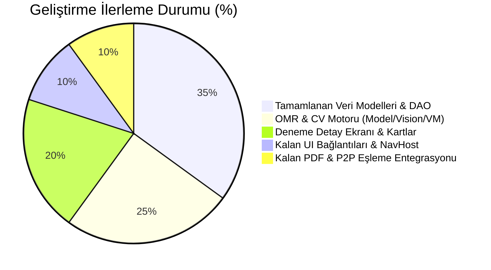

# Soru Defterim (`com.sorudefteri`) — Geliştirme Durum ve "Nerede Kaldık?" Raporu

**Tarih:** 28 Ekim 2026  
**Durum:** Temel Veri Katmanı ve Modeller Tamamlandı | Alt Ajanlar Durduruldu | Sıradaki Adımlar Belirlendi  
**Referans Tasarım Şartnamesi:** [`docs/OPTIK_DENEME_PDF_VE_ESLEME_MIMARISI.md`](file:///home/lenovo/Desktop/soru_uyg/docs/OPTIK_DENEME_PDF_VE_ESLEME_MIMARISI.md)

---

## 📊 Yönetici Özeti: Nerede Kaldık?

Kullanıcı talebi ("dur") doğrultusunda alt ajanlar sonlandırılmış ve o ana kadar tamamlanan tüm mimari altyapı güvenceye alınmıştır.

---

## 1. Modül Bazında Detaylı Durum Tablosu

| Modül | Planlanan Kapsam | Mevcut Durum | Nerede Kaldı? / Kalan İşler |
| :--- | :--- | :---: | :--- |
| **1. Deneme Sınavı & Çift Yönlü Soru Bağı** | `denemeId`, `denemeSoruNo`, Room v13 Migration, DAO sorguları, Deneme Detay ekranı | **%85 Tamamlandı** | `DenemeDetayScreen` ve `DenemeViewModel` yazıldı. Sadece `AppNavHost.kt` içine `DenemeDetayNav` rotasının bağlanması ve `SoruEklemeScreen`'de deneme etiketinin gösterilmesi kaldı. |
| **2. Kamera Tabanlı OMR (Optik Okuma)** | 4 Köşe Fiducial Tespiti, Skia `setPolyToPoly` Warp, Bağıl Kontrast Baloncuk Okuma, Karne Ekranı | **%75 Tamamlandı** | `OmrTemplate`, `OmrScanResult`, `FiducialDetector`, `PerspectiveWarper`, `BubbleReader` ve `OmrViewModel` yazıldı. `OmrScannerScreen.kt` (CameraX vizör) ve `OmrSonucScreen.kt` UI composable'larının eklenip `AppNavHost.kt`'ye bağlanması kaldı. |
| **3. Yeni Nesil PDF Kitapçık & Optik Form Motoru** | İki kademeli paragraf koruma, elastik sığdırma (%80-100), dikey çizgi düzeltmesi, tam sayfa A4 Optik Form | **%50 Tamamlandı** | `OmrMatrixCodeCodec.kt` (2D vektörel karekod motoru) ve `PdfExportConfig` yazıldı. `PdfSoruYerlesim.kt` (paragraf koruma/bin-packing) ve `PdfDenemeKitapcikGenerator.kt` (`drawPrintableOpticalFormPage` entegrasyonu) uygulanacak. |
| **4. YKS Derin İstatistikleri & Super-App Analitiği** | Net kayıp matrisi, Yayınevi performans radarı, Ebbinghaus/FSRS eğrisi, Hedef net simülatörü | **%80 Tamamlandı** | `DenemeDetayliAnalizCard.kt` ve `SuperAppAnalitikCards.kt` (4 adet profesyonel kart) yazıldı. `IstatistikScreen.kt` içine yerleştirilmeleri ve `DenemeTakipCard.kt` tıklama aksiyonunun bağlanması kaldı. |
| **5. Telefon ↔ Tablet Ambient Proximity P2P Eşleşmesi** | Güvenilir cihaz hafızası (Trusted Pair), yan yana sıfır tıkla arka plan eşitlenmesi, deneme/çizim aktarımı | **%40 Tamamlandı** | `BackupManager`'a `denemeId`, `denemeSoruNo` ve yeni deneme alanları eklendi. `TrustedDeviceStore.kt` ve `SyncProtokol.kt`'ye `DenemePaketMesaj` eklenmesi kaldı. |

---

## 2. Bu Aşamada Tamamlanan ve Yazılan Somut Dosyalar

### A. Veritabanı ve Çekirdek Veri Katmanı (Derlemeye Hazır)
- [`domain/model/DenemeSinavi.kt`](file:///home/lenovo/Desktop/soru_uyg/app/src/main/java/com/sorudefteri/domain/model/DenemeSinavi.kt): `testId`, `yayinEvi`, `sureDakika`, `toplamSoru`, `toplamDogru`, `toplamYanlis`, `toplamBos`, `cevapAnahtariJson`, `ogrenciCevaplariJson`, `updatedAt`, `isDeleted` alanları eklendi.
- [`data/local/entity/DenemeSinaviEntity.kt`](file:///home/lenovo/Desktop/soru_uyg/app/src/main/java/com/sorudefteri/data/local/entity/DenemeSinaviEntity.kt): Yeni sütunlar ve `testId` index'i eklendi.
- [`domain/model/Soru.kt`](file:///home/lenovo/Desktop/soru_uyg/app/src/main/java/com/sorudefteri/domain/model/Soru.kt) & [`data/local/entity/SoruEntity.kt`](file:///home/lenovo/Desktop/soru_uyg/app/src/main/java/com/sorudefteri/data/local/entity/SoruEntity.kt): `denemeId: Long?` ve `denemeSoruNo: Int?` çift yönlü ilişki kolonları eklendi.
- [`data/local/SoruDatabase.kt`](file:///home/lenovo/Desktop/soru_uyg/app/src/main/java/com/sorudefteri/data/local/SoruDatabase.kt) & [`di/DatabaseModule.kt`](file:///home/lenovo/Desktop/soru_uyg/app/src/main/java/com/sorudefteri/di/DatabaseModule.kt): Room veritabanı sürümü **13**'e yükseltildi ve `MIGRATION_12_13` güvenli geçiş kodu kaydedildi.
- [`data/local/dao/DenemeSinaviDao.kt`](file:///home/lenovo/Desktop/soru_uyg/app/src/main/java/com/sorudefteri/data/local/dao/DenemeSinaviDao.kt): `getByTestId`, `getDenemeByIdFlow`, `softDelete` ve güncellenen filtreler eklendi.
- [`data/local/dao/SoruDao.kt`](file:///home/lenovo/Desktop/soru_uyg/app/src/main/java/com/sorudefteri/data/local/dao/SoruDao.kt): `getSorularByDenemeId`, `getSorularByDenemeIdList`, `getDenemeSoruSayisi`, `getAllDenemeSorulari` metodları eklendi.
- [`domain/repository/SoruRepository.kt`](file:///home/lenovo/Desktop/soru_uyg/app/src/main/java/com/sorudefteri/domain/repository/SoruRepository.kt) & [`data/repository/SoruRepository.kt`](file:///home/lenovo/Desktop/soru_uyg/app/src/main/java/com/sorudefteri/data/repository/SoruRepository.kt): Deneme ve soru bağlama fonksiyonları uygulandı.
- [`ui/navigation/Screen.kt`](file:///home/lenovo/Desktop/soru_uyg/app/src/main/java/com/sorudefteri/ui/navigation/Screen.kt): `SoruEkleNav` (denemeId parametreli), `DenemeDetayNav`, `OmrScannerNav`, `OmrSonucNav` type-safe rotaları tanımlandı.

### B. Deneme Yönetimi ve Analitikler
- [`ui/deneme/DenemeViewModel.kt`](file:///home/lenovo/Desktop/soru_uyg/app/src/main/java/com/sorudefteri/ui/deneme/DenemeViewModel.kt): Deneme detay verileri, o denemeye ait yanlış sorular, hedefli tekrar testi başlatma mantığı.
- [`ui/deneme/DenemeDetayScreen.kt`](file:///home/lenovo/Desktop/soru_uyg/app/src/main/java/com/sorudefteri/ui/deneme/DenemeDetayScreen.kt): Deneme karnesi, ders dağılımı, yanlış/boş soru listesi, denemeye soru ekleme ve tekrar testi butonları.
- [`ui/istatistik/components/DenemeDetayliAnalizCard.kt`](file:///home/lenovo/Desktop/soru_uyg/app/src/main/java/com/sorudefteri/ui/istatistik/components/DenemeDetayliAnalizCard.kt): YKS Konu Bazlı Net Kayıp Tablosu (`-X.XX Net`).
- [`ui/istatistik/components/SuperAppAnalitikCards.kt`](file:///home/lenovo/Desktop/soru_uyg/app/src/main/java/com/sorudefteri/ui/istatistik/components/SuperAppAnalitikCards.kt): Yayınevi Karşılaştırma, Ebbinghaus Eğrisi, Hedef Net Simülatörü ve Bilişsel Hata Radarı.

### C. Kamera Tabanlı OMR (Optik Okuma) Çekirdeği
- [`domain/omr/model/OmrTemplate.kt`](file:///home/lenovo/Desktop/soru_uyg/app/src/main/java/com/sorudefteri/domain/omr/model/OmrTemplate.kt): A4 1200x1700 standart koordinatları, 120 soru baloncuk grid geometrisi.
- [`domain/omr/model/OmrScanResult.kt`](file:///home/lenovo/Desktop/soru_uyg/app/src/main/java/com/sorudefteri/domain/omr/model/OmrScanResult.kt): Optik okuma sonuç modelleri.
- [`domain/omr/vision/FiducialDetector.kt`](file:///home/lenovo/Desktop/soru_uyg/app/src/main/java/com/sorudefteri/domain/omr/vision/FiducialDetector.kt): 4 köşe referans karesi bulucu.
- [`domain/omr/vision/PerspectiveWarper.kt`](file:///home/lenovo/Desktop/soru_uyg/app/src/main/java/com/sorudefteri/domain/omr/vision/PerspectiveWarper.kt): Android Skia `setPolyToPoly` homografi motoru.
- [`domain/omr/vision/BubbleReader.kt`](file:///home/lenovo/Desktop/soru_uyg/app/src/main/java/com/sorudefteri/domain/omr/vision/BubbleReader.kt): Bağıl kontrast baloncuk analizcisi ve silinti filtresi.
- [`ui/omr/OmrViewModel.kt`](file:///home/lenovo/Desktop/soru_uyg/app/src/main/java/com/sorudefteri/ui/omr/OmrViewModel.kt): Görüntü analizi ve optik sonuç orkestrasyonu.
- [`data/pdf/OmrMatrixCodeCodec.kt`](file:///home/lenovo/Desktop/soru_uyg/app/src/main/java/com/sorudefteri/data/pdf/OmrMatrixCodeCodec.kt): 0 MB harici bağımlılıksız 2D vektörel karekod çizici ve okuyucu.

---

## 3. Sıradaki Eylem Adımları (Devam Edildiğinde Yapılacaklar)

1. **Adım 1:** `OmrScannerScreen.kt` ve `OmrSonucScreen.kt` UI Composable ekranlarının tamamlanması.
2. **Adım 2:** `AppNavHost.kt` içine `DenemeDetayNav`, `OmrScannerNav`, `OmrSonucNav` rotalarının eklenmesi.
3. **Adım 3:** `IstatistikScreen.kt` içine yeni analitik kartlarının entegre edilmesi.
4. **Adım 4:** `PdfSoruYerlesim.kt` (paragraf koruma/bin-packing) ve `PdfDenemeKitapcikGenerator.kt` (A4 Optik Form sayfası) güncellemelerinin tamamlanması.
5. **Adım 5:** `TrustedDeviceStore.kt` ve ambient sync paketlerinin eklenmesi.
6. **Adım 6:** `./gradlew testDebugUnitTest` ile tüm testlerin geçirilmesi.
