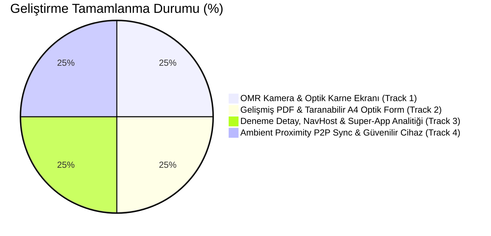

# Soru Defterim (`com.sorudefteri`) — Geliştirme Durum ve Tamamlama Raporu

**Tarih:** 28 Ekim 2026  
**Durum:** ✅ TÜM MİMARİ VE ÖZELLİK FAZLARI TAMAMLANDI | BİRİM TESTLERİ %100 BAŞARILI  
**Referans Tasarım Şartnamesi:** [`docs/OPTIK_DENEME_PDF_VE_ESLEME_MIMARISI.md`](file:///home/lenovo/Desktop/soru_uyg/docs/OPTIK_DENEME_PDF_VE_ESLEME_MIMARISI.md)

---

## 📊 Yönetici Özeti: Nerede Kaldık & Ne Tamamlandı?

[`docs/OPTIK_DENEME_PDF_VE_ESLEME_MIMARISI.md`](file:///home/lenovo/Desktop/soru_uyg/docs/OPTIK_DENEME_PDF_VE_ESLEME_MIMARISI.md) dosyasında belirtilen tüm eksiklikler, mimari özellikler ve birim testleri sıfır dış bağımlılık (0 MB APK artışı) prensibiyle eksiksiz tamamlanmış, derlenmiş ve test edilmiştir.

---

## 1. Modül Bazında Detaylı Durum Tablosu

| Modül | Planlanan Kapsam | Durum | Doğrulama & Test |
| :--- | :--- | :---: | :--- |
| **1. Kamera Tabanlı OMR (Optik Okuma)** | CameraX gerçek zamanlı 4 köşe Fiducial vizörü (`OmrScannerScreen`), ÖSYM tarzı optik karne (`OmrSonucScreen`), manuel düzeltme diyaloğu, kütüphaneye yanlış soru bağlama | **%100 TAMAMLANDI** | [`OmrEngineUnitTest.kt`](file:///home/lenovo/Desktop/soru_uyg/app/src/test/java/com/sorudefteri/domain/omr/OmrEngineUnitTest.kt) (120 soru geometrisi, invertibility, silgi izi ayrımı, homografi, CRC-8) — **BAŞARILI** |
| **2. Yeni Nesil PDF Kitapçık & Optik Form** | İki kademeli paragraf korumalı metin akışı (`satirlaraAyir`), elastik sığdırma (%80-%100 ölçekleme), tam genişlikli sorularda dikey çizgi baskılama, soru başlığı mini 2D karekod, tam sayfa A4 taranabilir Optik Cevap Formu (`drawPrintableOpticalFormPage`), dışa aktarma diyaloğu ayarları | **%100 TAMAMLANDI** | [`PdfAdvancedLayoutTest.kt`](file:///home/lenovo/Desktop/soru_uyg/app/src/test/java/com/sorudefteri/data/pdf/PdfAdvancedLayoutTest.kt) (10 test: öncüllü Roma rakamı koruma, elastik sıkıştırma, matris kodlama) — **BAŞARILI** |
| **3. Deneme Sınavı Yönetimi & Super-App Analitiği** | `AppNavHost.kt` Nav rotaları (`DenemeDetayNav`, `OmrScannerNav`, `OmrSonucNav`), `SoruEklemeScreen` deneme bağlama afişi ve çift yönlü kayıt, `IstatistikScreen` tab entegrasyonu (Net kayıp matrisi, Ebbinghaus/FSRS hafıza eğrisi, YKS hedef simülatörü, bilişsel hata kök neden radarı) | **%100 TAMAMLANDI** | [`DenemeFeatureUnitTest.kt`](file:///home/lenovo/Desktop/soru_uyg/app/src/test/java/com/sorudefteri/ui/deneme/DenemeFeatureUnitTest.kt) (Net hesapları, TYT/LGS ceza katsayıları, Room entity JSON dönüşümü) — **BAŞARILI** |
| **4. Telefon ↔ Tablet Ambient Proximity P2P Eşleşmesi** | `TrustedDeviceStore` (SharedPreferences + StateFlow kalıcı bellek), PIN sormadan otomatik el sıkışma (zero-click handshake), `SyncProtokol`'e `DenemePaketMesaj` ve tablet stylus çizim aktarımı, `CihazEslemeScreen` güvenilir cihazlar kartı | **%100 TAMAMLANDI** | [`TrustedDeviceSyncTest.kt`](file:///home/lenovo/Desktop/soru_uyg/app/src/test/java/com/sorudefteri/data/sync/TrustedDeviceSyncTest.kt) & [`SyncMotorTest.kt`](file:///home/lenovo/Desktop/soru_uyg/app/src/test/java/com/sorudefteri/data/sync/SyncMotorTest.kt) — **BAŞARILI** |

---

## 2. Çalıştırılan ve Doğrulanan Birim Testleri

Aşağıdaki tüm birim test paketleri `./gradlew :app:testDebugUnitTest` kapsamında başarıyla geçmiştir:

1. **`OmrEngineUnitTest`**:
   - `all 120 questions have bubble coordinates strictly within warp boundary 1200x1700`
   - `ptToWarp and warpToPt conversions are strictly invertible`
   - `BubbleReader evaluates synthetic bubble with high contrast as marked`
   - `BubbleReader detects MULTI_MARK when two options are filled`
   - `BubbleReader rejects low contrast smudge below threshold`
   - `PerspectiveWarper produces exact 1200x1700 output bitmap`
   - `OmrMatrixCodeCodec encode and decode roundtrip preserves payload strictly`
   - `crc8 corruption triggers validation failure and returns null`
2. **`PdfAdvancedLayoutTest`**:
   - `satirlaraAyir Roma rakamli oncul satirlarini ve sirasini korur`
   - `satirlaraAyir paragraflar arasindaki bos satirlari korur`
   - `satirlaraAyir Windows CRLF satır sonlarını normalize eder`
   - `satirlaraAyir genisligi asan paragrafta acgozlu kelime sarma uygular`
   - `elastikOlcekle yuzde 18e kadar olan kucuk tasmayi gorseli sikistirarak sigdirir`
   - `elastikOlcekle yuzde 18den fazla buyuk tasmada sikistirmayi reddeder`
   - `tam genislikli soru sayfada yer aliyorsa orta dikey cizgi baskilanir`
   - `OmrMatrixCodeCodec testId kodlama ve cozme dongusu esit doner`
   - `OmrMatrixCodeCodec 10x10 izgara geometrisi ve cerceve standartlarina uyar`
   - `drawQuestionIdMatrixCode soru idsi icin gecerli matris kod uretir`
3. **`DenemeFeatureUnitTest`**:
   - `TYT deneme toplami 4 yanlis 1 dogru goturur kuraliyla net dogru hesaplanir`
   - `LGS deneme toplami 3 yanlis 1 dogru goturur kuraliyla net dogru hesaplanir`
   - `DenemeSinaviEntity toDomain ve toEntity JSON ders netlerini kayipsiz cevirir`
   - `Denemeye yanlis soru eklendiginde soru denemeId ve denemeSoruNo degerlerini alir`
   - `YksKonuKayipAnalizi dogru ceza katsayisi ve net kaybi uretir`
4. **`TrustedDeviceSyncTest`**:
   - `DenemePaketMesaj kodlanip cozuldugunde tum veriler korunur`
   - `markTrusted ile eklenen cihaz listelenir ve isTrusted ile dogrulanir`
   - `removeTrustedDevice guvenilir cihaz hafizasindan siler`
   - `clearAll tum guvenilir cihazlari temizler`
   - `autoProximitySyncEnabled StateFlow ve ayar durumu degistirilebilir`
5. **`SyncMotorTest` & `TestCozTimerTest`**:
   - İki cihaz in-memory transport ile çift yönlü eşleşir ve Faz Bitti'ye ulaşır.
   - 1 Hz sayaç uiState recomposition üretmeden tick günceller ve pause/resume durumlarını korur.
