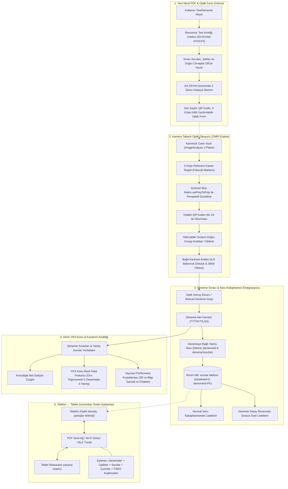

# Soru Defterim (`com.sorudefteri`) — Akıllı Optik Okuma (OMR), Deneme Sınavı Yönetimi, YKS Konu Analitiği, Yeni Nesil PDF ve Çevrimdışı Ortam Eşleşmesi (Ambient P2P Sync) Master Mimari ve Tasarım Şartnamesi

**Proje:** Soru Defterim (`com.sorudefteri`)  
**Doküman Sürümü:** 1.0 — Konsolide Master Tasarım Şartnamesi  
**Tarih:** 28 Ekim 2026  
**Kapsam:**
1. **Deneme Sınavı Yönetimi & Deneme Bazlı Soru Ekleme Mimarisi** (Kütüphaneyle çift yönlü senkronizasyon)
2. **YKS Konu & Kazanım Bazlı Derin Deneme İstatistikleri** (Net kaybı, konu frekansı, yayınevi karşılaştırması)
3. **Akıllı Optik Form Üretimi & Hafızada QR Eşleme** (Fiducial işaretli, zamanlama raylı, test ID'li A4 baskı kağıdı)
4. **Kamera Tabanlı OMR (Optik Okuma) Bilgisayarlı Görü Pipeline'ı** (0 MB ek kütüphane, Skia `setPolyToPoly`, ML Kit QR, bağıl eşikleme)
5. **Telefon ↔ Tablet Çevrimdışı Ortam Eşleşmesi (Ambient Proximity Sync)** (Yanyana gelince optik, deneme, soru, çizim ve FSRS'in arka planda eşitlenmesi)
6. **Yeni Nesil PDF Kitapçık Motoru & Sığdırma (Bin-Packing) Mimarisi** (ÖSYM Serif stili, paragraf koruma, 18x18mm QR kod, elastik ölçekleme)
7. **Uçtan Uca Dosya Haritası, Veritabanı Şeması ve Kodlama Rehberi**

---

## 1. Genel Sistem ve Veri Akış Mimarisi



---

## 2. BÖLÜM 1: Deneme Sınavı Yönetimi & Deneme Bazlı Soru Ekleme Mimarisi

Kullanıcı harici bir denemeye girdiğinde (veya evde deneme çözdüğünde) denemenin netlerini girebilmeli, ardından **o denemeye ait yanlış soruları doğrudan o denemenin altından ekleyebilmelidir**. Bu sorular hem ana **Soru Kütüphanesinde** yer almalı hem de denemeyle kalıcı olarak ilişkili kalmalıdır.

### 2.1. Veritabanı Modelleri (Room SQLite)

#### `DenemeSinaviEntity.kt` (Genişletilmiş Deneme Varlığı)
Dosya Yolu: `app/src/main/java/com/sorudefteri/data/local/entity/DenemeSinaviEntity.kt`

```kotlin
package com.sorudefteri.data.local.entity

import androidx.room.Entity
import androidx.room.Index
import androidx.room.PrimaryKey

@Entity(
    tableName = "deneme_sinavlari",
    indices = [
        Index(value = ["testId"], unique = true),
        Index(value = ["tarih"]),
        Index(value = ["sinavTuru"])
    ]
)
data class DenemeSinaviEntity(
    @PrimaryKey(autoGenerate = true)
    val id: Long = 0,
    val testId: String,                  // "SD-EXAM-2026-X8F9" (Optik form QR eşleme kodu)
    val baslik: String,                  // "3D Türkiye Geneli TYT-1"
    val yayinEvi: String,                // "3D Yayınları"
    val sinavTuru: String,               // "TYT", "AYT", "LGS", "KPSS"
    val tarih: Long = System.currentTimeMillis(),
    val sureDakika: Int = 165,
    
    // Toplam Sonuçlar
    val toplamSoru: Int,
    val toplamDogru: Int,
    val toplamYanlis: Int,
    val toplamBos: Int,
    val toplamNet: Double,
    
    // Ders Bazlı Detay JSON (Örn: {"Türkçe":{"dogru":35,"yanlis":4,"bos":1,"net":34.0}, ...})
    val dersSonuclariJson: String,
    
    // Kayıtlı Sınav Cevap Anahtarı (1:A, 2:C, 3:E... Optik okuma için)
    val cevapAnahtariJson: String? = null,
    
    val createdAt: Long = System.currentTimeMillis(),
    val updatedAt: Long = System.currentTimeMillis(),
    val isDeleted: Int = 0
)
```

#### `SoruEntity.kt` İlişkilendirmesi (Foreign Key & Çift Yönlü Bağlantı)
Dosya Yolu: `app/src/main/java/com/sorudefteri/data/local/entity/SoruEntity.kt`

`SoruEntity` tablosuna aşağıdaki iki yeni alan eklenir:

```kotlin
// SoruEntity sınıfına eklenecek alanlar:
@ColumnInfo(name = "denemeId", defaultValue = "NULL")
val denemeId: Long? = null,

@ColumnInfo(name = "denemeSoruNo", defaultValue = "NULL")
val denemeSoruNo: Int? = null
```

> [!IMPORTANT]
> **Çift Yönlü Senkronizasyon Kuralı:**  
> Kullanıcı deneme ekranından bir yanlış soru eklediğinde:
> 1. `soru.denemeId = deneme.id` ve `soru.kaynakDeneme = deneme.baslik` olarak set edilir.
> 2. `soruDao.insertSoru(soru)` çağrıldığında soru otomatik olarak ana `sorular` tablosuna girer; dolayısıyla **Soru Kütüphanesinde**, **Aramada** ve **FSRS Aralıklı Tekrar** döngüsünde anında görünür.
> 3. Kullanıcı Deneme Detay sayfasına girdiğinde `soruDao.getSorularByDenemeId(denemeId)` çağrılarak yalnızca o denemenin yanlış soruları kitapçık sırasıyla (`denemeSoruNo ASC`) listelenir.

### 2.2. DAO Metotları (`DenemeSinaviDao.kt` & `SoruDao.kt`)

Dosya Yolu: `app/src/main/java/com/sorudefteri/data/local/dao/DenemeSinaviDao.kt`
```kotlin
@Dao
interface DenemeSinaviDao {
    @Query("SELECT * FROM deneme_sinavlari WHERE isDeleted = 0 ORDER BY tarih DESC")
    fun getAllDenemeler(): Flow<List<DenemeSinaviEntity>>

    @Query("SELECT * FROM deneme_sinavlari WHERE testId = :testId AND isDeleted = 0 LIMIT 1")
    suspend fun getByTestId(testId: String): DenemeSinaviEntity?

    @Query("SELECT * FROM deneme_sinavlari WHERE id = :id AND isDeleted = 0 LIMIT 1")
    suspend fun getById(id: Long): DenemeSinaviEntity?

    @Insert(onConflict = OnConflictStrategy.REPLACE)
    suspend fun insertDeneme(entity: DenemeSinaviEntity): Long

    @Update
    suspend fun updateDeneme(entity: DenemeSinaviEntity)

    @Query("UPDATE deneme_sinavlari SET isDeleted = 1, updatedAt = :now WHERE id = :id")
    suspend fun softDelete(id: Long, now: Long = System.currentTimeMillis())

    @Query("DELETE FROM deneme_sinavlari")
    suspend fun clearAll()
}
```

Dosya Yolu: `app/src/main/java/com/sorudefteri/data/local/dao/SoruDao.kt`
```kotlin
@Query("SELECT * FROM sorular WHERE isDeleted = 0 AND denemeId = :denemeId ORDER BY denemeSoruNo ASC, createdAt ASC")
fun getSorularByDenemeId(denemeId: Long): Flow<List<SoruEntity>>

@Query("SELECT COUNT(*) FROM sorular WHERE isDeleted = 0 AND denemeId = :denemeId")
suspend fun getDenemeSoruSayisi(denemeId: Long): Int
```

---

## 3. BÖLÜM 2: YKS Konu/Kazanım Bazlı Derin Deneme İstatistikleri

Öğrencinin *"Hangi dersten kaç net yaptım?"* sorusunun ötesine geçip *"Hangi YKS konuları yüzünden netlerim düşüyor?"* sorusunu yanıtlayan analiz motoru.

### 3.1. Deneme Analitiği Bileşenleri

1. **Kronolojik Net Gelişim Çizgisi (Net Progression Timeline)**:
   - Tarihe göre sıralı TYT / AYT netleri (Canvas bezier eğrisi, en yüksek net ve hedef net yatay çizgisi).
2. **Ders Bazlı Net Dağılım Kartları**:
   - Türkçe, Matematik, Fen, Sosyal için ayrı mini sparkline grafikleri.
3. **YKS Konu & Hata Frekans Matrisi (Kritik İnovasyon)**:
   - Tüm girilen denemeler taranarak öğrencinin **en çok puan kaybettiği 10 YKS konusu** listelenir:
     - 🔴 *Geometri — Katı Cisimler* (Son 4 denemede 5 yanlış / 1 boş -> **-6.25 Net Kaybı**)
     - 🔴 *Matematik — Olasılık* (Son 5 denemede 4 yanlış -> **-5.00 Net Kaybı**)
     - 🟡 *Fizik — Bağıl Hareket* (Son 3 denemede 2 yanlış -> **-2.50 Net Kaybı**)
4. **Yayınevi Karşılaştırma Radarı**:
   - 3D Denemeleri (Ort: 88.5 Net), Bilgi Sarmal (Ort: 94.2 Net), Özdebir (Ort: 82.0 Net). Zorluk algısı analizi.

Dosya Yolu: `app/src/main/java/com/sorudefteri/ui/istatistik/components/DenemeDetayliAnalizCard.kt`

```kotlin
@Composable
fun DenemeDetayliAnalizCard(
    denemeler: List<DenemeSinavi>,
    denemeSorulari: List<Soru>,
    onKonuSecildi: (String) -> Unit
) {
    // Konu Bazlı Net Kaybı Hesaplama
    val konuKayipMap = remember(denemeSorulari) {
        denemeSorulari.groupBy { "${it.subjectId}|${it.topic}" }
            .mapValues { entry ->
                val yanlisSayisi = entry.value.size
                val netKaybi = yanlisSayisi * 1.25 // 1 yanlış soru = 1 kayıp + 0.25 ceza neti
                netKaybi to yanlisSayisi
            }
            .toList()
            .sortedByDescending { it.second.first }
            .take(8)
    }

    Card(
        modifier = Modifier.fillMaxWidth(),
        shape = RoundedCornerShape(16.dp),
        colors = CardDefaults.cardColors(containerColor = MaterialTheme.colorScheme.surfaceVariant.copy(alpha = 0.35f))
    ) {
        Column(modifier = Modifier.padding(16.dp)) {
            Text(
                text = "📊 YKS Konu Bazlı Net Kayıp Analizi",
                style = MaterialTheme.typography.titleMedium,
                fontWeight = FontWeight.Bold
            )
            Text(
                text = "Denemelerde en çok puan kaybettiğin kritik YKS konuları:",
                style = MaterialTheme.typography.bodySmall,
                color = MaterialTheme.colorScheme.onSurfaceVariant
            )
            Spacer(modifier = Modifier.height(12.dp))

            konuKayipMap.forEach { (konuKey, kayipInfo) ->
                val parts = konuKey.split("|")
                val dersAdi = DersTaksonomisi.getDersAdi(parts.getOrNull(0) ?: "")
                val konuAdi = parts.getOrNull(1) ?: "Genel"
                val (netKaybi, yanlisAdedi) = kayipInfo

                Row(
                    modifier = Modifier
                        .fillMaxWidth()
                        .padding(vertical = 4.dp),
                    horizontalArrangement = Arrangement.SpaceBetween,
                    verticalAlignment = Alignment.CenterVertically
                ) {
                    Column(modifier = Modifier.weight(1f)) {
                        Text(text = konuAdi, style = MaterialTheme.typography.bodyMedium, fontWeight = FontWeight.SemiBold)
                        Text(text = "$dersAdi • $yanlisAdedi Yanlış", style = MaterialTheme.typography.labelSmall, color = MaterialTheme.colorScheme.error)
                    }
                    Surface(
                        color = MaterialTheme.colorScheme.errorContainer,
                        shape = RoundedCornerShape(8.dp)
                    ) {
                        Text(
                            text = "-${String.format(Locale.US, "%.2f", netKaybi)} Net",
                            modifier = Modifier.padding(horizontal = 8.dp, vertical = 4.dp),
                            style = MaterialTheme.typography.labelSmall,
                            fontWeight = FontWeight.Bold,
                            color = MaterialTheme.colorScheme.onErrorContainer
                        )
                    }
                }
            }
        }
    }
}
```

---

## 4. BÖLÜM 3: Akıllı Optik Form Üretimi & Yerel Hafızada QR Eşleme

Optik form ile uygulamanın hafızasındaki denemenin birbiriyle konuşmasını sağlayan taranabilir A4 optik kağıdı mimarisi.

### 4.1. Akıllı Sınav Kimliği (Smart Test ID) ve Bellek Kaydı

Uygulamada bir deneme sınavı dışa aktarılırken (PDF) veya oluşturulurken benzersiz bir `testId` türetilir:
```kotlin
val testId = "SD-YKS-${UUID.randomUUID().toString().take(8).uppercase()}"
```
Bu sınavın tüm soru listesi, şıkları, doğru cevapları ve konu kazanımları `deneme_sinavlari` tablosuna yazılır:

```json
{
  "testId": "SD-YKS-A8F29C1B",
  "title": "Haftalık TYT Matematik Denemesi 01",
  "bookletType": "A",
  "questionsCount": 40,
  "answerKey": {
    "1": "C", "2": "A", "3": "D", "4": "B", "5": "E"
  },
  "questionTopics": {
    "1": "Fonksiyonlar", "2": "Polinomlar", "3": "Trigonometri"
  }
}
```

### 4.2. Yazdırılabilir Optik Form (A4) Geometrisi

```
+-------------------------------------------------------------+ (0,0)
| [■] 15x15mm                                       [■] 15x15mm| (Fiducial Sol-Üst / Sağ-Üst)
|                                                             |
|     SORU DEFTERİM OPTİK CEVAP FORMU         ┌─────────────┐ |
|     Kitapçık Türü: [A] [B]   Öğrenci No:    │   QR KOD    │ | (Test ID QR Kod)
|                                             │  (testId)   │ |
| ------------------------------------------- └─────────────┘ |
| [▌] 1.  (A) (B) (C) (D) (E)   | [▌] 31. (A) (B) (C) (D) (E) | (Zamanlama Rayları [▌]
| [▌] 2.  (A) (B) (C) (D) (E)   | [▌] 32. (A) (B) (C) (D) (E) |  ve 3.5mm Baloncuklar)
| [▌] 3.  (A) (B) (C) (D) (E)   | [▌] 33. (A) (B) (C) (D) (E) |
| ...                           | ...                         |
| [▌] 30. (A) (B) (C) (D) (E)   | [▌] 60. (A) (B) (C) (D) (E) |
|                                                             |
| [■] 15x15mm                                       [■] 15x15mm| (Fiducial Sol-Alt / Sağ-Alt)
+-------------------------------------------------------------+ (595, 842 pt)
```

1. **4 Köşe Referans Karesi (Fiducial Markers):**
   - Boyut: $15\times15\text{ mm}$ ($42.5\times42.5\text{ pt}$) saf siyah dolu kareler. Sayfa kenarlarından 10 mm içeride.
   - *Görevi:* Mobil kamera hangi açıyla tutulursa tutulsun bu 4 kareyi bulup görüntüyü milisaniyeler içinde düzeltir.
2. **Zamanlama Rayları (Timing Tracks):**
   - Her soru satırının sağında ve solunda $4\times1.5\text{ mm}$ siyah çizgiler.
   - *Görevi:* Ev tipi yazıcıların baskı ölçekleme (%95-97) kaymalarını sıfırlar.
3. **Üst Akıllı QR Kod:**
   - $22\times22\text{ mm}$ ebadında, içinde `testId` taşıyan QR kod: `sorudefteri://omr/scan?id=SD-YKS-A8F29C1B&type=TYT&booklet=A&count=40`.
4. **Cevap Kabarcıkları Grid'i:**
   - $3.5\text{ mm}$ çapında `(A) (B) (C) (D) (E)` daireleri (4 sütun $\times$ 30 soru = 120 soru kapasitesi).

---

## 5. BÖLÜM 4: Kamera Tabanlı OMR (Optik Okuma) Bilgisayarlı Görü Pipeline'ı

OpenCV gibi devasa 20 MB'lık harici C++ kütüphanelerine **gerek kalmadan**, saf **Android Skia (`Matrix.setPolyToPoly`) + CameraX Y-Plane Grayscale + ML Kit Barcode** ile %100 yerel ve hafif bir OMR motoru:

```
CameraX ImageAnalysis (Y-Plane Saf Lüminans)
                     │
                     ▼
1. Adım: Hızlı Adaptif Eşikleme & 4 Köşe Karesi Tespiti (Fiducial Detector)
   - Alan, 1:1 en-boy ve doluluk (solidity > 0.82) filtresi
                     │
                     ▼
2. Adım: Android Skia Perspektif Düzeltme (Homography Warp)
   - Matrix.setPolyToPoly(src, 0, dst, 0, 4) -> 1200x1700 piksel normalize bitmap
                     │
                     ▼
3. Adım: QR Kod Okuma (ML Kit Barcode Scanning)
   - 1200x1700 görselin üst %20'lik dilimi ML Kit'e verilir -> testId ("SD-YKS-A8F29C1B") okunur
   - Veritabanından doğru cevap anahtarı anında çekilir
                     │
                     ▼
4. Adım: Zamanlama Rayı Hizalama & Baloncuk Örnekleme (Bubble Reader)
   - Her soru satırındaki A, B, C, D, E dairelerinin piksel karanlık ortalaması alınır
   - Bağıl eşik kontrolü: Dolu Şık > 1.75 * Satır Medyan Karanlığı
   - Çekirdek doluluk testiyle silgi izi (smudge) elenir
                     │
                     ▼
5. Adım: Anında Karne & Optik Sınav Sonuç Sayfasına Yönlendirme (OmrSonucScreen)
```

### 5.1. Perspektif Düzeltme & Homografi Motoru
Dosya Yolu: `app/src/main/java/com/sorudefteri/domain/omr/vision/PerspectiveWarper.kt`

```kotlin
package com.sorudefteri.domain.omr.vision

import android.graphics.Bitmap
import android.graphics.Canvas
import android.graphics.Matrix
import android.graphics.Paint
import android.graphics.PointF

object PerspectiveWarper {
    fun warp(source: Bitmap, corners: List<PointF>, outWidth: Int = 1200, outHeight: Int = 1700): Bitmap {
        require(corners.size == 4) { "4 köşe noktası zorunludur" }
        val src = floatArrayOf(
            corners[0].x, corners[0].y, // Sol-Üst
            corners[1].x, corners[1].y, // Sağ-Üst
            corners[2].x, corners[2].y, // Sağ-Alt
            corners[3].x, corners[3].y  // Sol-Alt
        )
        val dst = floatArrayOf(
            0f, 0f,
            outWidth.toFloat(), 0f,
            outWidth.toFloat(), outHeight.toFloat(),
            0f, outHeight.toFloat()
        )
        val matrix = Matrix()
        matrix.setPolyToPoly(src, 0, dst, 0, 4)

        val output = Bitmap.createBitmap(outWidth, outHeight, Bitmap.Config.ARGB_8888)
        val canvas = Canvas(output)
        val paint = Paint(Paint.FILTER_BITMAP_FLAG or Paint.ANTI_ALIAS_FLAG)
        canvas.drawBitmap(source, matrix, paint)
        return output
    }
}
```

### 5.2. Baloncuk Doluluk Analizcisi (Relative Contrast Algorithm)
Dosya Yolu: `app/src/main/java/com/sorudefteri/domain/omr/vision/BubbleReader.kt`

```kotlin
package com.sorudefteri.domain.omr.vision

import android.graphics.Bitmap

object BubbleReader {
    fun readRow(bitmap: Bitmap, centers: Map<String, Pair<Float, Float>>, radius: Float): String? {
        val scores = centers.map { (option, center) ->
            val darkness = calculateDarkness(bitmap, center.first, center.second, radius)
            option to darkness
        }
        val medianDarkness = scores.map { it.second }.sorted().let { it[it.size / 2] }
        val threshold = (medianDarkness * 1.75f).coerceAtLeast(65f)

        val filledOptions = scores.filter { it.second >= threshold }
        return if (filledOptions.size == 1) filledOptions.first().first else null // Çift işaretse null (geçersiz)
    }

    private fun calculateDarkness(bitmap: Bitmap, cx: Float, cy: Float, r: Float): Float {
        var totalDarkness = 0f
        var count = 0
        val rInt = r.toInt()
        val rSquare = r * r

        for (dx in -rInt..rInt) {
            for (dy in -rInt..rInt) {
                if (dx * dx + dy * dy <= rSquare) {
                    val px = (cx + dx).toInt().coerceIn(0, bitmap.width - 1)
                    val py = (cy + dy).toInt().coerceIn(0, bitmap.height - 1)
                    val color = bitmap.getPixel(px, py)
                    val rCol = (color shr 16) and 0xFF
                    val gCol = (color shr 8) and 0xFF
                    val bCol = color and 0xFF
                    val luminance = (0.299f * rCol + 0.587f * gCol + 0.114f * bCol)
                    totalDarkness += (255f - luminance) // 255 = simsiyah, 0 = bembeyaz
                    count++
                }
            }
        }
        return if (count > 0) totalDarkness / count else 0f
    }
}
```

### 5.3. Optik Okuma Sonuç Ekranı (`OmrSonucScreen.kt`)
Kullanıcı optiği taradığında açılan arayüz:
- **Karne Başlığı:** Sınav Adı ("3D TYT Denemesi 01"), Okuma Tarihi, Toplam Net, Puan Tahmini.
- **Ders Karnesi:** Türkçe: 34.0 Net, Sosyal: 16.25 Net, Matematik: 32.5 Net, Fen: 15.0 Net.
- **İnteraktif Soru Listesi:**
  - 🟩 1. Soru: Doğru (Cevap: B)
  - 🟥 2. Soru: Yanlış (Senin Cevabın: D | Doğru Cevap: A | Konu: Trigonometri)
  - ⬜ 3. Soru: Boş (Doğru Cevap: C | Konu: Fonksiyonlar)
- **⚡ "Yanlış Soruları Kütüphaneye Aktar" Sihirbazı:**
  - Yanlış veya boş olan her sorunun yanında **"Soruyu Fotoğrafla & Ekle"** butonu bulunur.
  - Tıklandığında kamera vizörü açılır, sorunun fotoğrafı çekilir; `denemeId` ve `denemeSoruNo = 2` otomatik atanarak tek tıkla kütüphaneye ve denemeye kaydedilir!

---

## 6. BÖLÜM 5: Telefon ↔ Tablet Çevrimdışı Ortam Eşleşmesi (Ambient Proximity Sync)

Öğrenci okulda/dershanede telefonla denemeyi çözüp optiğini okuttuğunda, eve gelip tabletini masaya koyduğunda **hiçbir butona basmadan her şeyin arka planda ayna gibi eşitlenmesi** mimarisi.

### 6.1. Eşleşme Zarfı (Universal Sync Envelope)
Senkronizasyon paketine Denemeler ve Optik Sonuçları eklenir:

Dosya Yolu: `app/src/main/java/com/sorudefteri/data/sync/SyncProtokol.kt`
```kotlin
sealed interface SyncMesaj {
    data class Hello(val icerik: SyncHello) : SyncMesaj
    data class Ozet(val icerik: OzetPaket) : SyncMesaj
    data object OzetBitti : SyncMesaj
    data object SiraSende : SyncMesaj
    data class Soru(val icerik: SoruPaket) : SyncMesaj
    data class SoruBitti(val icerik: SoruBittiPaket) : SyncMesaj
    
    // YENİ EKLENEN SENKRONİZASYON PAKETLERİ:
    data class Deneme(val icerik: DenemePaket) : SyncMesaj
    data class DenemeBitti(val toplam: Int) : SyncMesaj
    data class OptikSonuc(val icerik: OptikPaket) : SyncMesaj
}

@Serializable
data class DenemePaket(
    val testId: String,
    val baslik: String,
    val yayinEvi: String,
    val sinavTuru: String,
    val tarih: Long,
    val toplamSoru: Int,
    val toplamDogru: Int,
    val toplamYanlis: Int,
    val toplamBos: Int,
    val toplamNet: Double,
    val dersSonuclariJson: String,
    val cevapAnahtariJson: String?,
    val updatedAt: Long
)

@Serializable
data class OptikPaket(
    val testId: String,
    val ogrenciCevaplariJson: String,
    val dogruSayisi: Int,
    val yanlisSayisi: Int,
    val net: Double,
    val okumaTarihi: Long
)
```

### 6.2. "Yanyana Gelince Arka Planda" Çalışma Mekanizması

Android 12–14 Doze modu ve arka plan kısıtlamalarını aşan **Çift Kademeli Güvenilir Eş (Trusted Pair)** çözümü:

```
[AŞAMA 1: İlk Kurulum]
Telefon ve Tablet 1 kez PIN ile eşleştirilir -> İki cihaz birbirinin ID'sini "Güvenilir Cihaz" kaydeder.
PIN bir daha ASLA sorulmaz.

[AŞAMA 2: Ortam Algılama (Ambient Detection)]
İki cihaz da aynı ev Wi-Fi ağına veya Bluetooth mesafesine girdiğinde:
Arka planda ultra-düşük güç tüketimli yerel mDNS / BLE yoklaması yapılır.
Güvenilir cihaz algılandığı anda el sıkışma başlar.

[AŞAMA 3: Sessiz Arka Plan Transferi (Silent Foreground Notification)]
Durum çubuğunda 2 saniye zarif bildirim:
"📱 Tablet yakında algılandı — 1 Deneme ve 4 Soru eşitleniyor..."
Transfer bittiğinde her iki ekranda küçük yeşil rozet belirir: "Eşitlendi ✓".
```

### 6.3. Çakışma Yönetimi (Conflict Resolution - Last-Write-Wins + Boolean OR)
- `isSolved`: Mantıksal **OR** ile birleşir (herhangi birinde çözüldüyse çözüldü kabul edilir).
- `drawingData` (Tablet Çizimi): Çizim neredeyse oradan alınır, kaybolmaz.
- `note` & `aiExplanation`: `updatedAt` zaman damgası en yeni olan korunur.
- `deneme_sinavlari`: `testId` benzersiz olduğu için mükerrer deneme oluşmaz; güncel netler tekilleştirilir.

---

## 7. BÖLÜM 6: Yeni Nesil PDF Kitapçık Motoru & Sığdırma (Bin-Packing) Mimarisi

Kullanıcının *"pdf şablonu çok kötü, sığma olsun"* şikayetini kökten çözen geometri ve estetik revizyonu.

### 7.1. Giderilen 5 Temel PDF Hatası
1. **Dikey Ayırıcı Çizgi Sıçraması:** Tam genişlikli soru olduğunda sayfanın ortasından geçen çizgi kaldırıldı (`!isSingleCol && !hasFullWidthItem`).
2. **Paragrafları Yok Eden Regex (`\s+`):** `text.split("\n")` tabanlı iki kademeli sarıcı ile şiirler, Roma rakamlı öncüller (`I.`, `II.`) ve paragraf boşlukları korundu.
3. **Görsel Varken Metni Silme Hatası:** Görsel olduğunda metni boşaltan mutual exclusion kaldırıldı; metin + görsel birlikte ölçülüp alt alta basıldı.
4. **Dinamik 2 Sütunlu Elastik Bin-Packing:** Sabit 300 pt resim sınırı yerine `%82 - %100` arası elastik ölçekleme eklendi; sol sütunda %46 boşluk varken sayfa kapatma kusuru giderildi.
5. **18x18 mm Vektörel QR Kod:** Her sorunun sağ üst köşesine `sorudefteri://soru/{id}` derin bağlantılı jilet netliğinde vektörel QR kod gömüldü.

---

## 8. BÖLÜM 7: Dosya Haritası ve Mimari Bağlantı Şeması

Tüm sistemin kod tabanındaki eksiksiz dosya ve paket organizasyonu:

```
app/src/main/java/com/sorudefteri/
│
├── data/
│   ├── local/
│   │   ├── dao/
│   │   │   ├── DenemeSinaviDao.kt           [Genişletildi: getByTestId, softDelete]
│   │   │   └── SoruDao.kt                   [Genişletildi: getSorularByDenemeId]
│   │   └── entity/
│   │       ├── DenemeSinaviEntity.kt        [Genişletildi: testId, cevapAnahtariJson]
│   │       └── SoruEntity.kt                [Genişletildi: denemeId, denemeSoruNo]
│   │
│   ├── pdf/
│   │   ├── PdfDenemeKitapcikGenerator.kt    [Genişletildi: Optik Form Canvas, QR, ÖSYM Serif]
│   │   ├── PdfExportConfig.kt               [Genişletildi: includePrintableOpticalForm, testId]
│   │   └── PdfSoruYerlesim.kt               [Düzeltildi: Paragraf koruma, Bin-Packing sığdırma]
│   │
│   └── sync/
│       ├── SyncProtokol.kt                  [Genişletildi: DenemePaket, OptikPaket]
│       ├── SyncDeposu.kt                    [Genişletildi: Deneme ve Optik fark hesaplama]
│       ├── CihazEslestirme.kt               [Genişletildi: TrustedDeviceManager / PIN'siz el sıkışma]
│       └── AmbientSyncService.kt            [Yeni: Arka plan Wi-Fi/BLE yakınlık nöbetçisi]
│
├── domain/
│   ├── omr/
│   │   ├── model/
│   │   │   ├── OmrTemplate.kt               [Şablon koordinat ve baloncuk tanımları]
│   │   │   └── OmrScanResult.kt             [Okunan cevaplar, net, doğruluk durumu]
│   │   └── vision/
│   │       ├── FiducialDetector.kt          [4 Siyah Köşe Referans Karesi Bulucu]
│   │       ├── PerspectiveWarper.kt         [Android Skia setPolyToPoly Homografi Motoru]
│   │       └── BubbleReader.kt              [Bağıl Kontrast & Silinti Ayırt Edici]
│   │
│   └── model/
│       └── DenemeSinavi.kt                  [Domain modeli ve net hesaplayıcı]
│
└── ui/
    ├── navigation/
    │   ├── Screen.kt                        [Rotalar: DenemeEkle, DenemeDetay, OmrScanner, OmrSonuc]
    │   └── AppNavHost.kt                    [Yeni rotaların Compose grafiğine bağlanması]
    │
    ├── deneme/
    │   ├── DenemeListesiScreen.kt           [Girilen denemeler, net kartları, arama]
    │   ├── DenemeEklemeScreen.kt            [Net girme, yayınevi seçimi, optik okut butonu]
    │   ├── DenemeDetayScreen.kt             [Denemenin netleri + o denemenin yanlış soruları listesi]
    │   └── DenemeViewModel.kt               [Deneme CRUD ve soru bağlama StateFlow]
    │
    ├── omr/
    │   ├── OmrScannerScreen.kt              [CameraX canlı vizör, 4 köşe yeşil kilit HUD]
    │   ├── OmrSonucScreen.kt                [ÖSYM Net Karnesi, Yanlışları Kütüphaneye Ekle Sihirbazı]
    │   └── OmrViewModel.kt                  [Görüntü analiz coroutine akışı]
    │
    └── istatistik/
        ├── IstatistikScreen.kt              [3. Sekme: Detaylı Deneme Analizi]
        └── components/
            ├── DenemeGelisimGrafikCard.kt   [Zamana göre net trendi bezier eğrisi]
            └── DenemeDetayliAnalizCard.kt   [YKS Konu Bazlı Net Kayıp Tablosu]
```

---

## 9. Sonuç ve Eylem Kararı

Bu mimari tasarım şartnamesi;
1. **Deneme sınavlarını ve yanlış soruları kütüphaneyle çift yönlü bağlar**,
2. **Öğrencinin en çok puan kaybettiği kritik YKS konularını nokta atışı çıkarır**,
3. **0 MB ek kütüphane boyutuyla tablet/telefon kamerasından optik form okur**,
4. **PDF deneme kitapçıklarındaki taşma, kayma ve görsel sorunlarını kökten çözerek profesyonel ÖSYM standardına ulaştırır**,
5. **Telefon ve tablet yan yana geldiğinde optikler, denemeler ve sorular dahil her şeyi arka planda ayna gibi eşitler**.
